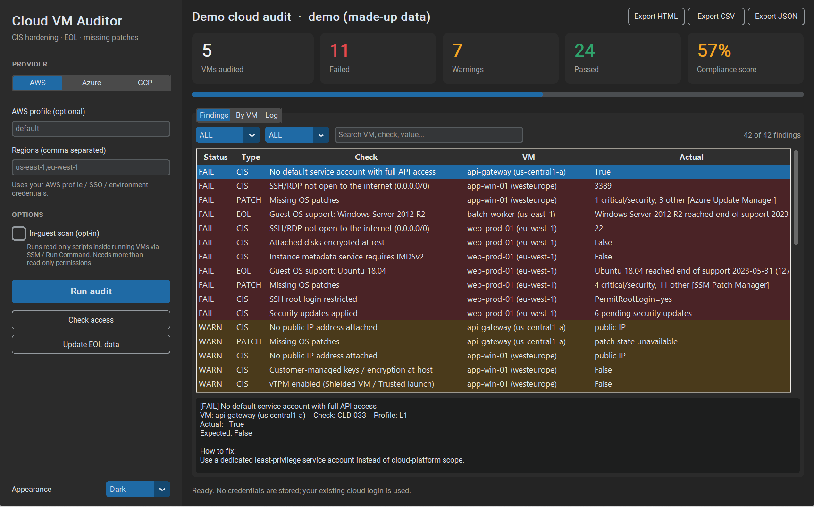
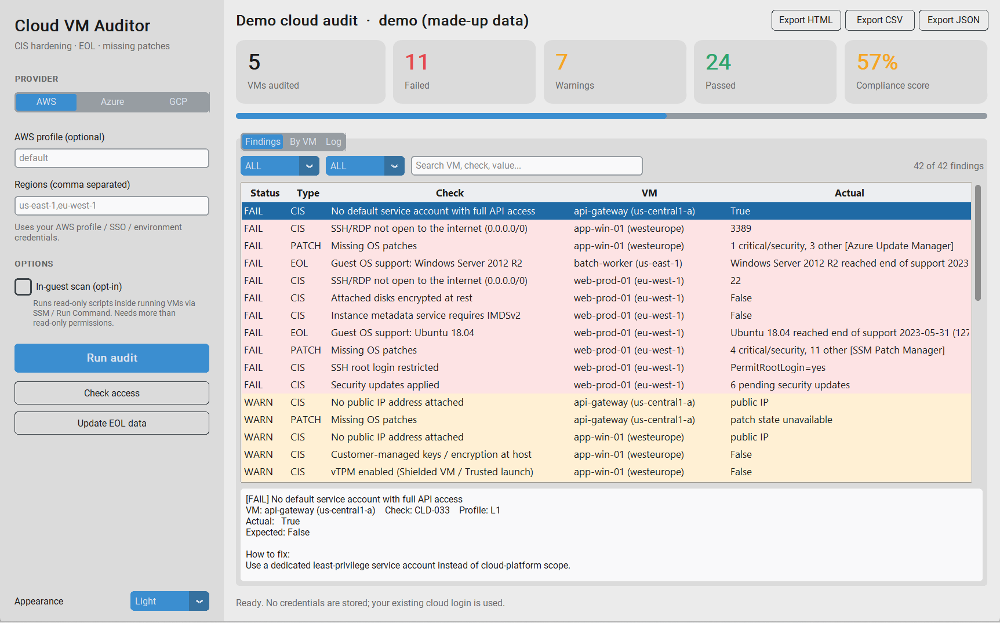

# Cloud VM CIS, EOL & Patch Auditor

[](https://github.com/3tternp/cloud-vm-cis-audit/actions/workflows/tests.yml)  

Audit of **AWS EC2, Azure VMs and GCP Compute Engine** instances: CIS-style configuration checks, guest-OS end of support, missing patches, and an optional in-guest hardening scan. It uses your existing cloud login; no keys are entered or stored. Companion to [vmware-vcenter-esxi-cis-audit](https://github.com/3tternp/vmware-vcenter-esxi-cis-audit).

## Desktop GUI
```powershell
pip install -r requirements.txt
python cloud_audit_gui.py
```
<p>
 
</p>

> Screenshots use **made-up demo data** (`tools/make_screenshot.py`), not a real environment.

1. Pick **AWS**, **Azure** or **GCP** and fill the one or two fields (AWS profile/regions, Azure subscription ID, GCP project ID). No keys or passwords are entered: it uses your existing login (AWS profile/SSO, `az login`, `gcloud auth application-default login`).
2. Click **Check access** once to see which read-only APIs your credentials can call, then **Run audit**.
3. Read the result cards (VMs, failed, warnings, passed, score). **Findings** has status/type filters, search, and a "how to fix" panel for the selected row; **By VM** ranks machines by failures (double-click to drill in); **Log** shows progress.
4. Export HTML, CSV or JSON. **Update EOL data** refreshes guest-OS lifecycle dates. **In-guest scan** is off by default and asks for confirmation. Dark, light and system themes are supported.

### Windows executable
No Python needed on the target machine: download `CloudVMAuditor.exe` from the [Releases](https://github.com/3tternp/cloud-vm-cis-audit/releases) page (or the `build-exe` workflow artifact) and verify it against the published `.sha256`. It is the same GUI, with the AWS, Azure and GCP SDKs bundled. You still need your own cloud login on that machine (AWS profile/SSO, `az login`, `gcloud auth application-default login`).

Build it yourself (uses an isolated `.venv-build`, your global Python is untouched):
```powershell
powershell -ExecutionPolicy Bypass -File build_exe.ps1     # -> dist\CloudVMAuditor.exe
```
The exe is unsigned, so Windows SmartScreen may warn on first run ("More info" > "Run anyway"). It is a GUI-only build; use the Python CLI for headless runs. Pushing a tag like `v0.1.0` makes the `build-exe` workflow build the exe and attach it to a GitHub release.

## Command line
```powershell
pip install -r requirements.txt
python cloud_audit_cli.py --cloud aws --check-access --regions us-east-1     # 1) see which APIs your credentials can call
python cloud_audit_cli.py --cloud aws --regions us-east-1,eu-west-1 [--profile myprofile]
python cloud_audit_cli.py --cloud azure --subscription <subscription-id>     # after: az login
python cloud_audit_cli.py --cloud gcp --project <project-id>                  # after: gcloud auth application-default login
python cloud_audit_cli.py --update-eol                                        # refresh guest-OS EOL dates from endoflife.date
```
Writes `cloud_audit.html`, `.csv` and `.json` (`--out` changes the prefix). Requires Python 3.10+ (the GUI needs Tkinter, bundled with the standard Windows/macOS installers; on Debian/Ubuntu `sudo apt install python3-tk`).

## Checks
| ID | Check | Providers |
|---|---|---|
| CLD-001 | No public IP attached | all |
| CLD-002 | SSH/RDP not open to the internet (firewall rules evaluated by priority, deny rules honoured) | all |
| CLD-005 | Public IP protected by an NSG | Azure |
| CLD-003/004 | Disks encrypted; customer-managed keys / encryption at host (L2) | all |
| CLD-010 | IMDSv2 required | AWS |
| CLD-020..022 | Secure Boot, vTPM, integrity monitoring (L2) | Azure, GCP |
| CLD-030..033 | Block project SSH keys, OS Login, serial console off, no default SA with full API access | GCP |
| CLD-EOL | Guest OS end of support | all |
| CLD-PATCH | Missing OS patches, with the data source shown | all |
| GUEST-* | In-guest hardening (opt-in): SSH, accounts, firewall, auditd, time sync, ASLR, SELinux/AppArmor, pending security updates; Windows firewall, SMBv1, Defender, NLA, UAC, password policy, hotfix age | AWS, Azure |

### How patch data is obtained
| Provider | Source | Without it |
|---|---|---|
| AWS | SSM Patch Manager; **fallback: Amazon Inspector** package findings (agentless); instances in neither are listed as "not managed by SSM" with the fix | WARN with remediation |
| Azure | Azure Update Manager assessment | WARN |
| GCP | VM Manager inventory + vulnerability report (needs `google-cloud-os-config`) | WARN (unknown, never "0 missing") |

### Network exposure
Azure traffic must pass both the subnet NSG and the NIC NSG (intersection), first matching rule by priority wins. GCP VPC firewall rules are ordered by priority with deny honoured. AWS security groups are allow-only. Hierarchical GCP firewall policies and AWS network ACLs are not evaluated.

### OS end-of-support data
`cloud_audit/data/os_eol.json` ships with dates compiled on its `verified` date. `--update-eol` rebuilds the rules from endoflife.date into `~/.cloud_audit/os_eol.json` (takes precedence; falls back per product if offline). The CLI warns when the data is older than 180 days. Unrecognised OS strings are reported as INFO, never silently passed.

## In-guest scan (opt-in, `--guest-scan`)
Runs the bundled scripts in [`cloud_audit/guest/`](cloud_audit/guest) inside running VMs through the provider agent: **AWS SSM Run Command** and **Azure Run Command**. The scripts are short, read-only (a test asserts they contain no mutating commands) and print `CIS|id|STATUS|detail` lines. The CLI shows what will happen and asks you to type `yes` (or pass `--yes`). Review the scripts before enabling.

Needs more than read-only access: AWS `ssm:SendCommand` + `ssm:GetCommandInvocation`, Azure `Microsoft.Compute/virtualMachines/runCommand/action` (e.g. Virtual Machine Contributor). GCP has no agentless execution channel here, so GCP VMs are skipped. This is a focused CIS-aligned subset, not a full CIS-CAT scan.

## Minimum read-only access
AWS: `ec2:Describe{Instances,SecurityGroups,Volumes,Images}`, `ssm:DescribeInstanceInformation`, `ssm:DescribeInstancePatchStates`, optional `inspector2:ListFindings`. Azure: Reader. GCP: `roles/compute.viewer` (+ `roles/osconfig.inventoryViewer`, `roles/osconfig.vulnerabilityReportViewer` for patch data).

## Scheduling
[docs/examples/cloud-audit-aws.yml](docs/examples/cloud-audit-aws.yml) is a GitHub Actions example (OIDC, no stored keys). Copy it to `.github/workflows/` to enable it.

## Testing and what is not proven
```powershell
python tests/test_cloud.py        # checks, network rules, patch logic, guest parser, EOL rule builder
python tests/test_collectors.py   # each collector against stub SDKs
python tests/test_gui_model.py    # GUI filtering / per-VM roll-up logic (headless)
```
Both run in CI without any cloud SDK or credentials. They prove the logic and call sequencing, **not** that the live APIs return exactly these shapes; this tool has not yet run against real AWS, Azure or GCP accounts. Run `--check-access` and a first scan in a non-production account, and report anything that differs.

Remaining limits: Azure patch data requires an Update Manager assessment; AWS network ACLs and GCP hierarchical policies are not evaluated; the in-guest scan is a subset of CIS controls.

## License
[MIT](LICENSE)
